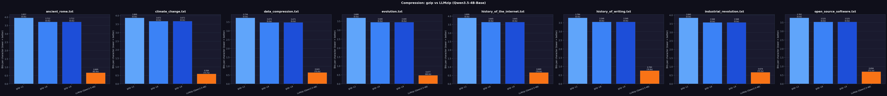

# GenDiff

Research code for generative reconstruction compression (GRC). `experiments/generative_reconstruction_compression/simple_grc.py` compresses a token-level diff between a reference text and a revised text. Inserted tokens are arithmetic-coded the same way as LLMzip. The file layout of a `.grczip` stream is described in that module's docstring.



`compression_benchmark.png` is the chart written by `compression_benchmark.py`, which compresses the same text with gzip (levels 1, 6, 9) and with LLMzip (`Qwen/Qwen3.5-4B-Base`, bfloat16, KV cache) and reports bytes, bits per character, and wall-clock time.

## Tech

- Python 3.10+ (`pyproject.toml`)
- PyTorch and Hugging Face Transformers for the language model's next-token probabilities
- NumPy cumulative-frequency tables feeding an arithmetic coder derived from Nayuki's reference arithmetic coding (see `REFERENCES.md`)
- Matplotlib for plots, pytest for the unit tests

## Layout

- `core/` holds the arithmetic coder (`core/AC/`), `continuous_bitstream.py`, and the LLMzip wrappers `encode_story.py` and `decode_story.py`.
- `experiments/generative_reconstruction_compression/` holds the GRC encoders (`simple_grc.py`, `pointer_grc.py`), `run_benchmark.py`, and `baseline_llmzip.py`.
- `experiments/benchmark_programs/` holds cached and augmented program samples.
- `utils/myers_diff.py` holds a Myers diff implementation.
- `corpus/` holds short text files.
- `compression_benchmark.py` compares gzip with LLMzip.
- `REFERENCES.md` notes the arithmetic coder and the LLMzip paper.

## Setup

```sh
python3 -m venv .venv
. .venv/bin/activate
pip install -e .
```

`pip install -e .` installs the dependencies listed in `pyproject.toml` (torch, numpy, transformers, accelerate, pydantic, matplotlib, python-dotenv). Install the PyTorch build that matches your GPU, or the CPU build, first if you need a specific one. Add `pytest` to run the tests.

## Running

`compression_benchmark.py` says to run this from the project root:

```sh
python3 compression_benchmark.py
```

It downloads the first 100 KB of enwik8 to `/tmp/enwik8_100k.txt` if it is not cached, and loads `Qwen/Qwen3.5-4B-Base` from Hugging Face.

`core/encode_story.py` and `core/decode_story.py` take `--model`, `--input`, `--output`, `--window-size`, and `--bf16`.

`simple_grc.py`'s `main` reads `nbody_seed.txt`, `nbody_prompt.txt`, `nbody_candidate.py`, and `nbody_candidate_revised.py` from its own directory. Those files are not in this repository.

## Tests

```sh
pip install pytest
python -m pytest
```

`test_continuous_bitstream.py` and `test_ac_rewind.py` check the bit stream and the arithmetic decoder's bit accounting without loading a model; CI runs them on CPU. `test_pointer_grc.py` holds a manual end-to-end check (`run_e2e_test`) that loads `Qwen/Qwen3.5-4B-Base`; pytest does not collect it.

## License

MIT, see `LICENSE`. `core/AC/arithmeticcoding.py` is based on Nayuki's reference arithmetic coding; see `REFERENCES.md`.
