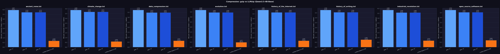

# GenDiff

Research code for generative reconstruction compression (GRC). `experiments/generative_reconstruction_compression/simple_grc.py` compresses a token-level diff between a reference text and a revised text. Inserted tokens are arithmetic-coded the same way as LLMzip. The file layout of a `.grczip` stream is described in that module's docstring.



`compression_benchmark.png` is the chart written by `compression_benchmark.py`, which compresses each file in `corpus/` with gzip (levels 1, 6, 9) and with LLMzip (`Qwen/Qwen3.5-4B-Base`, bfloat16, KV cache) and reports bytes, bits per character, and wall-clock time.

## Tech

- Python 3.10+ (`pyproject.toml`)
- PyTorch and Hugging Face Transformers for the language model's next-token probabilities
- NumPy cumulative-frequency tables feeding an arithmetic coder derived from Nayuki's reference arithmetic coding (see `REFERENCES.md`)
- Matplotlib for plots
- pytest, Ruff, and mypy for the unit tests, lint, and type check

## Layout

- `core/` holds the arithmetic coder (`core/AC/`), `continuous_bitstream.py`, framed arithmetic blocks (`core/ac_frame.py`), and the LLMzip wrapper `core/llmzip_utils.py`. `core/encode_story.py` and `core/decode_story.py` are the command-line encode and decode scripts.
- `experiments/generative_reconstruction_compression/` holds the GRC encoders (`simple_grc.py`, `pointer_grc.py`), `run_benchmark.py`, and `baseline_llmzip.py`.
- `experiments/benchmark_programs/` holds cached and augmented program samples.
- `utils/myers_diff.py` holds a Myers diff implementation.
- `corpus/` holds short text files.
- `compression_benchmark.py` compares gzip with LLMzip.
- `REFERENCES.md` notes the arithmetic coder and the LLMzip paper.

## Setup

```sh
python3 -m venv .venv
. .venv/bin/activate
```

Install a CPU build of PyTorch first if you do not want the default CUDA wheel, then install this project:

```sh
pip install --index-url https://download.pytorch.org/whl/cpu torch
pip install -e ".[dev]"
```

`pip install -e ".[dev]"` installs the runtime dependencies in `pyproject.toml` (numpy, transformers, accelerate, pydantic, matplotlib, python-dotenv) and the dev tools pytest, Ruff, and mypy. Use the PyTorch build that matches your GPU instead of the CPU index when you are going to run a model.

## Usage

Encode and decode a text file with LLMzip. Both commands download the model on first use and are not part of CI:

```sh
python core/encode_story.py \
    --model Qwen/Qwen3.5-4B-Base \
    --input corpus/ancient_rome.txt \
    --output ancient_rome.llmzip

python core/decode_story.py \
    --model Qwen/Qwen3.5-4B-Base \
    --input ancient_rome.llmzip \
    --output ancient_rome.decoded.txt
```

`--window-size` sets the context window (default 50). `--bf16` selects bfloat16. The device is CUDA when it is available, otherwise CPU.

Compare gzip with LLMzip on `corpus/`:

```sh
python3 compression_benchmark.py
```

That loads `Qwen/Qwen3.5-4B-Base` and writes `compression_benchmark.png`.

`python -m experiments.generative_reconstruction_compression.simple_grc` reads `nbody_seed.txt`, `nbody_prompt.txt`, `nbody_candidate.py`, and `nbody_candidate_revised.py` from that package directory. Those files are not in this repository.

`test_pointer_grc.py` is a manual end-to-end check (`run_e2e_test`) that loads `Qwen/Qwen3.5-4B-Base`. pytest does not collect it. `smoke_tps_bench.py` requires a CUDA GPU and the same model.

## Tests and checks

The unit tests exercise the bit stream, the arithmetic coder, Myers diff, GRC opcode coalescing, and LLMzip / pointer-GRC round-trips. The model tests use a tiny in-process bigram, so they do not download weights. GPU benchmarks are outside this suite.

```sh
python -m pytest
ruff check .
mypy
```

GitHub Actions runs those three commands on Ubuntu with CPU PyTorch. It does not download a language model or the enwik8 corpus.

## License

MIT, see `LICENSE`. `core/AC/arithmeticcoding.py` is based on Nayuki's reference arithmetic coding; see `REFERENCES.md`.
